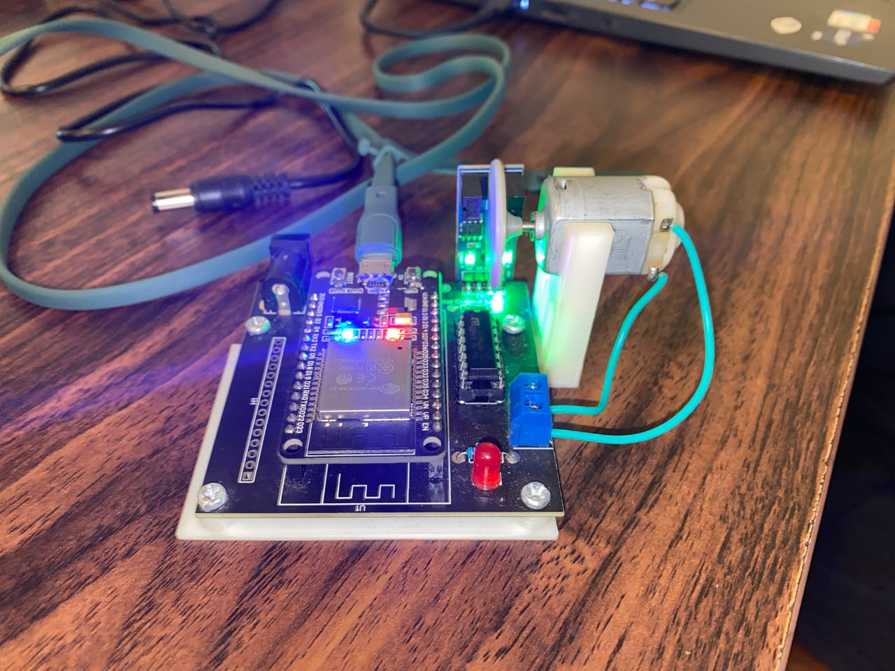

# LAPORAN PRAKTIKUM UTS ROBOTIKA

**Sistem Kendali Robotika Berbasis Kit iMCLab (ESP32)**

---

## BAB 1: PENDAHULUAN & SPESIFIKASI SISTEM

### 1.1 Latar Belakang

Praktikum ini bertujuan untuk mengimplementasikan sistem kontrol tertanam (_embedded system_) menggunakan Kit Robotika iMCLab berbasis mikrokontroler ESP32. Pengujian diawali dengan pengenalan dasar kontrol I/O dan komunikasi serial, yang menjadi fondasi utama untuk pengembangan modul-modul kontrol robotika tingkat lanjut.

### 1.2 Spesifikasi Perangkat Keras dan Perangkat Lunak

- **Mikrokontroler:** ESP32 Dev Module (Chip USB-to-UART Silicon Labs CP2102)
- **Kit Eksternal:** iMCLab Trainer Kit (LED indikator, Driver Motor DC)
- **Lingkungan Pengembangan (IDE):** Arduino IDE v2.3.10
- **Core Board Support Package:** ESP32 Core v2.x / v3.x Compatible
- **Port Komunikasi Active:** `COM10` (Silicon Labs CP210x Universal Windows Driver)
- **Parameter Serial:** Baudrate $115200$ bps, Data Bits 8, Parity None, Stop Bits 1

---

## BAB 2: CATATAN TROUBLESHOOTING & REKAPITULASI SOLUSI TEKNIS

Dalam proses konfigurasi awal dan pengunggahan program, ditemukan beberapa kendala teknis yang berhasil diatasi melalui analisis sistematis:

### 2.1 Identifikasi Port Serial dan Instalasi Driver CP2102

- **Masalah:** Arduino IDE tidak dapat berkomunikasi dengan ESP32 karena port default terdeteksi pada `COM3` yang merupakan port internal sistem (`Intel Active Management Technology`).
- **Diagnosis:** Perangkat ESP32 terdeteksi pada Device Manager di bawah kelompok _Other devices_ dengan status _CP2102 USB to UART Bridge Controller_ (tanda seru kuning) karena driver USB belum terinstal.
- **Solusi:** Mengunduh dan menginstal _Silicon Labs CP210x Universal Windows Driver_. Setelah instalasi selesai, port ESP32 secara otomatis berpindah ke kelompok _Ports (COM & LPT)_ dengan alokasi port baru pada **`COM10`**.

### 2.2 Penanganan Galat Upload (`Exit Status 2` & `The chip stopped responding`)

- **Masalah:** Proses _upload_ mengalami kegagalan (_timeout_) dengan pesan kesalahan `Failed to connect to ESP32: No serial data received` serta `The chip stopped responding`.
- **Diagnosis:**
  1. Kecepatan _upload_ standar ($921600$ bps) terlalu tinggi sehingga tidak stabil pada jalur komunikasi USB serial.
  2. Pin `GPIO 12` pada ESP32 terhubung ke driver motor Kit iMCLab. Karena `GPIO 12` merupakan _strapping pin_ pembacaan memori flash, adanya tegangan balik dari driver motor mencegah ESP32 memasuki _Bootloader Mode_.
- **Solusi:**
  1. Menurunkan kecepatan pengunggahan (_Upload Speed_) di Arduino IDE dari `921600` menjadi **`115200`**.
  2. Mematikan sakelar daya eksternal ke motor kit saat proses _flashing_.
  3. Menerapkan prosedur manual eksekusi bootloader: menekan dan menahan tombol **BOOT**, menekan tombol **EN/RST** satu kali, lalu melepaskan tombol BOOT saat status `Writing at...` mulai muncul di konsol.

### 2.3 Kompatibilitas Versi ESP32 Core (PWM LEDC API)

- **Masalah:** Terjadi galat kompilasi `error: 'ledcAttach' was not declared in this scope` saat menggunakan skrip standar.
- **Diagnosis:** Sintaks `ledcAttach(pin, freq, resolution)` merupakan API baru khusus untuk ESP32 Core v3.x, sedangkan lingkungan kerja menggunakan ESP32 Core v2.x yang membutuhkan fungsi `ledcSetup()` dan `ledcAttachPin()`.
- **Solusi:** Menyusun kembali kode menggunakan arahan kompilasi terkondisi (_conditional compilation directives_) `#if defined(ESP_ARDUINO_VERSION_MAJOR)` sehingga skrip bersifat universal dan kompatibel di seluruh versi ESP32 Core.

---

## BAB 3: MODUL 1 – BASIC ARDUINO / ESP32 SERIAL CONTROL

### 3.1 Tujuan Modul

1. Mengonfigurasi komunikasi serial antara komputer dan ESP32 pada kecepatan $115200$ baud.
2. Mengontrol status _On/Off_ actuator (LED dan Motor DC) melalui perintah karakter ASCII via Serial Monitor.
3. Memastikan fungsi kontrol PWM dan I/O dasar berjalan stabil sebelum memasuki modul navigasi lanjutan.

### 3.2 Kode Program Universal Modul 1

```cpp
/*
 * Modul 1 – Basic Arduino / ESP32 (Universal Core 2.x & 3.x)
 * Kendali LED dan motor DC melalui Serial Monitor.
 */

#include <Arduino.h>

constexpr uint8_t LED_PIN = 2;
constexpr uint8_t MOTOR_IN1_PIN = 27;
constexpr uint8_t MOTOR_IN2_PIN = 26;
constexpr uint8_t MOTOR_PWM_PIN = 12;
constexpr uint32_t PWM_FREQUENCY = 30000;
constexpr uint8_t PWM_RESOLUTION = 8;
constexpr uint8_t MOTOR_DUTY = 200; // Rentang 0-255

constexpr uint8_t PWM_CHANNEL = 0;
bool pwmReady = false;

void setMotor(bool enabled) {
  const uint8_t duty = enabled ? MOTOR_DUTY : 0;
  digitalWrite(MOTOR_IN1_PIN, enabled ? HIGH : LOW);
  digitalWrite(MOTOR_IN2_PIN, LOW);

  if (pwmReady) {
    #if defined(ESP_ARDUINO_VERSION_MAJOR) && ESP_ARDUINO_VERSION_MAJOR >= 3
      ledcWrite(MOTOR_PWM_PIN, duty);
    #else
      ledcWrite(PWM_CHANNEL, duty);
    #endif
  }

  digitalWrite(LED_PIN, enabled ? HIGH : LOW);
}

void setup() {
  Serial.begin(115200);
  pinMode(LED_PIN, OUTPUT);
  pinMode(MOTOR_IN1_PIN, OUTPUT);
  pinMode(MOTOR_IN2_PIN, OUTPUT);
  pinMode(MOTOR_PWM_PIN, OUTPUT);

  #if defined(ESP_ARDUINO_VERSION_MAJOR) && ESP_ARDUINO_VERSION_MAJOR >= 3
    pwmReady = ledcAttach(MOTOR_PWM_PIN, PWM_FREQUENCY, PWM_RESOLUTION);
  #else
    ledcSetup(PWM_CHANNEL, PWM_FREQUENCY, PWM_RESOLUTION);
    ledcAttachPin(MOTOR_PWM_PIN, PWM_CHANNEL);
    pwmReady = true;
  #endif

  setMotor(false);

  if (!pwmReady) {
    Serial.println("ERROR: PWM setup failed. Check ESP32 core and pin configuration.");
  } else {
    Serial.println("READY: Send 1 to turn ON, 0 to turn OFF.");
  }
}

void loop() {
  if (Serial.available() > 0) {
    char ch = Serial.read();
    if (ch == '1') {
      setMotor(true);
      Serial.println("State: ON");
    } else if (ch == '0') {
      setMotor(false);
      Serial.println("State: OFF");
    }
  }
}
```

### 3.3 Hasil Pengujian dan Analisis

1. **Inisialisasi Sistem:**
   Saat modul ESP32 di-reset, Serial Monitor pada kecepatan $115200$ baud berhasil menerima pesan status bootloader dilanjutkan dengan pesan indikator:
   ```text
   entry 0x400805f0
   READY: Send 1 to turn ON, 0 to turn OFF.
   ```
2. **Pengujian Perintah '1' (State ON):**
   - Input karakter `'1'` dikirim melalui kolom input Serial Monitor.
   - Respon Serial Monitor: `State: ON`.
   - Kondisi Fisik Alat: LED indikator pada GPIO 2 menyala dan sinyal PWM aktif mendorong pergerakan motor DC.
3. **Pengujian Perintah '0' (State OFF):**
   - Input karakter `'0'` dikirim melalui kolom input Serial Monitor.
   - Respon Serial Monitor: `State: OFF`.
   - Kondisi Fisik Alat: LED indikator mati dan sinyal PWM dihentikan ($duty = 0$).

---

## BAB 4: DOKUMENTASI PENGUJIAN

_(Selipkan hasil tangkapan layar dan foto fisik alat pada bagian ini)_

1. **[Gambar 4.1] Screenshot Serial Monitor Modul 1**
    
   - _Keterangan:_ Tampilan Serial Monitor menunjukkan status `READY`, balasan `State: ON` saat diberi masukan `1`, dan `State: OFF` saat diberi masukan `0`.
2. **[Gambar 4.2] Dokumentasi Fisik Kit iMCLab (Kondisi Aktif & Mati)**
   
   - _Keterangan:_ Indikator LED dan aktuator motor Kit iMCLab merespons instruksi serial dengan presisi.

---

## BAB 5: RENCANA KELANJUTAN (MODUL 2–4)

Setelah pengujian Modul 1 dinyatakan sukses dan stabil, tahap berikutnya adalah:

- **Modul 2:** Pengujian Sensor Jarak / Pembacaan Analog & Digital.
- **Modul 3:** Implementasi Kontrol Motor & Pergerakan Kinematika Robot.
- **Modul 4:** Pengintegrasian Algoritma Utama Navigasi / Autonomous System.
