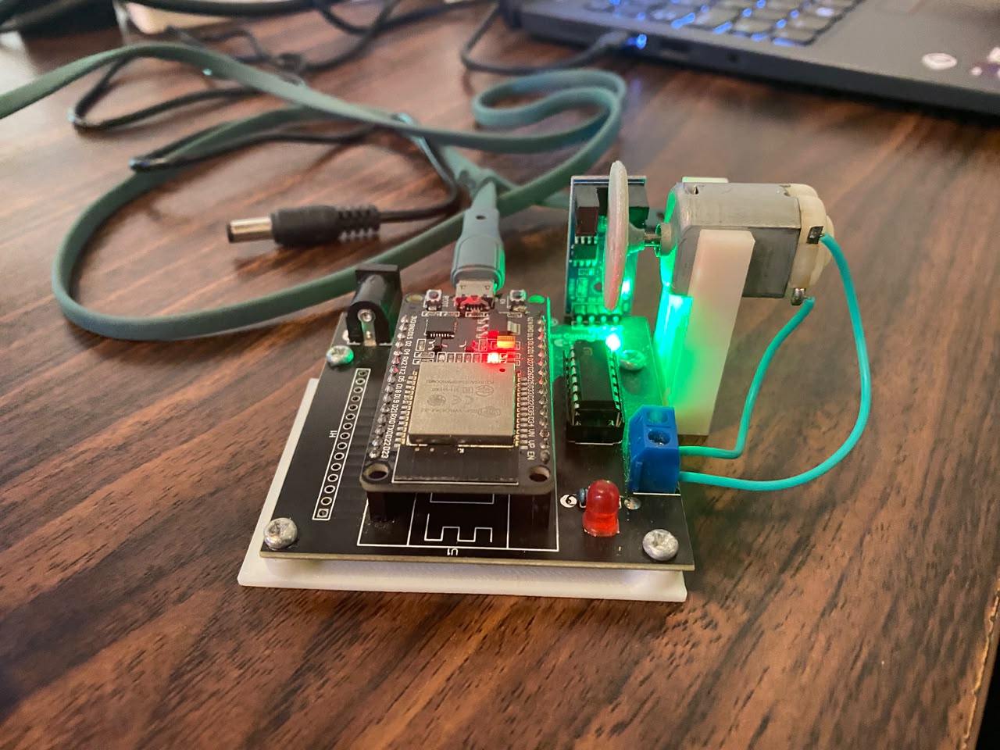

# LAPORAN PRAKTIKUM UTS ROBOTIKA — MODUL 2

**Integrasi Pemrograman Hibrida (C++ & Python) untuk Kendali Kecepatan Motor DC (PWM) dan Pembacaan Quadrature Encoder pada ESP32**

---

## BAB 1: PENDAHULUAN & SPESIFIKASI MODUL 2

### 1.1 Latar Belakang

Pada Modul 2 praktikum Robotika, fokus utama ditujukan pada kendali kecepatan dan arah putar motor DC menggunakan modulasi lebar pulsa (_Pulse Width Modulation_ / PWM) serta umpan balik posisi/kecepatan menggunakan _Quadrature Optical Encoder_. Sistem dikembangkan menggunakan pendekatan **arsitektur hibrida**:

1. **Low-Level Controller (C++ / ESP32):** Bertindak sebagai _firmware slave_ untuk mengeksekusi sinyal PWM, membaca pulsa encoder via _Interrupt Service Routine_ (ISR), dan memproses perintah serial.
2. **High-Level Controller (Python / PC):** Bertindak sebagai _master interface_ di PC/Laptop yang mengirimkan instruksi kendali dan memantau telemetri _encoder_ menggunakan antarmuka `pyserial`.

### 1.2 Spesifikasi Sistem & Pinout Hardware

- **Mikrokontroler:** ESP32 Dev Module ($115200\text{ baud}$, Port `COM10`)
- **Driver Motor:** H-Bridge Onboard Kit iMCLab
- **Konfigurasi Pin ESP32:**
  - `MOTOR_IN1_PIN` $\rightarrow$ GPIO 27 (Arah Putar 1)
  - `MOTOR_IN2_PIN` $\rightarrow$ GPIO 26 (Arah Putar 2)
  - `MOTOR_PWM_PIN` $\rightarrow$ GPIO 12 (Sinyal PWM Kecepatan)
  - `ENCODER_A_PIN` $\rightarrow$ GPIO 34 (Pin Interrupt Utama - Phase A)
  - `ENCODER_B_PIN` $\rightarrow$ GPIO 35 (Pin Pembacaan Arah - Phase B)
  - `LED_PIN` $\rightarrow$ GPIO 2 (Indikator Aktivitas System)
- **Parameter PWM:** Frekuensi $30\text{ kHz}$, Resolusi $8\text{-bit}$ (Rentang _Duty Cycle_ $0 \text{ s.d. } 255$)
- **Spesifikasi Encoder:** $CPR = 330$ (_Counts Per Revolution_)

---

## BAB 2: KODE PROGRAM HIBRIDA (C++ & PYTHON)

### 2.1 Kode Firmware ESP32 (C++ / Arduino IDE)

Kode C++ berikut bertugas menangani perangkat keras secara langsung, mendukung **ESP32 Core v2.x & v3.x**, dan siap menerima parsing data berbasis baris dari Python.

```cpp
/*
 * Modul 2 – Firmware ESP32 Kendali Motor & Encoder
 * Kit iMCLab - UTS Robotika
 */

#include <Arduino.h>

constexpr uint8_t LED_PIN = 2;
constexpr uint8_t MOTOR_IN1_PIN = 27;
constexpr uint8_t MOTOR_IN2_PIN = 26;
constexpr uint8_t MOTOR_PWM_PIN = 12;

constexpr uint8_t ENCODER_A_PIN = 34;
constexpr uint8_t ENCODER_B_PIN = 35;

constexpr uint32_t PWM_FREQUENCY = 30000;
constexpr uint8_t PWM_RESOLUTION = 8;
constexpr uint8_t PWM_CHANNEL = 0;

volatile long encoderTicks = 0;
bool pwmReady = false;

// Interrupt Service Routine (ISR) Pembacaan Encoder
void IRAM_ATTR readEncoder() {
  if (digitalRead(ENCODER_B_PIN) == HIGH) {
    encoderTicks++;
  } else {
    encoderTicks--;
  }
}

void setMotorSpeed(int speed) {
  bool forward = speed >= 0;
  uint8_t duty = constrain(abs(speed), 0, 255);

  digitalWrite(MOTOR_IN1_PIN, forward ? HIGH : LOW);
  digitalWrite(MOTOR_IN2_PIN, forward ? LOW : HIGH);

  if (pwmReady) {
    #if defined(ESP_ARDUINO_VERSION_MAJOR) && ESP_ARDUINO_VERSION_MAJOR >= 3
      ledcWrite(MOTOR_PWM_PIN, duty);
    #else
      ledcWrite(PWM_CHANNEL, duty);
    #endif
  }
  digitalWrite(LED_PIN, duty > 0 ? HIGH : LOW);
}

void setup() {
  Serial.begin(115200);

  pinMode(LED_PIN, OUTPUT);
  pinMode(MOTOR_IN1_PIN, OUTPUT);
  pinMode(MOTOR_IN2_PIN, OUTPUT);
  pinMode(MOTOR_PWM_PIN, OUTPUT);

  pinMode(ENCODER_A_PIN, INPUT_PULLUP);
  pinMode(ENCODER_B_PIN, INPUT_PULLUP);

  attachInterrupt(digitalPinToInterrupt(ENCODER_A_PIN), readEncoder, RISING);

  #if defined(ESP_ARDUINO_VERSION_MAJOR) && ESP_ARDUINO_VERSION_MAJOR >= 3
    pwmReady = ledcAttach(MOTOR_PWM_PIN, PWM_FREQUENCY, PWM_RESOLUTION);
  #else
    ledcSetup(PWM_CHANNEL, PWM_FREQUENCY, PWM_RESOLUTION);
    ledcAttachPin(MOTOR_PWM_PIN, PWM_CHANNEL);
    pwmReady = true;
  #endif

  setMotorSpeed(0);
  Serial.println("MODUL 2 ESP32 READY: Menunggu Perintah Serial...");
}

unsigned long lastPrintTime = 0;

void loop() {
  // Pembacaan string dari Python / Serial Terminal
  if (Serial.available() > 0) {
    String inputStr = Serial.readStringUntil('\n');
    inputStr.trim();

    if (inputStr.length() > 0) {
      int inputSpeed = inputStr.toInt();
      setMotorSpeed(inputSpeed);
      Serial.print("Kecepatan diset ke: ");
      Serial.println(inputSpeed);
    }
  }

  // Kirim data telemetri Ticks Encoder setiap 100ms
  if (millis() - lastPrintTime >= 100) {
    lastPrintTime = millis();
    Serial.print("Encoder Ticks: ");
    Serial.println(encoderTicks);
  }
}
```

### 2.2 Skrip Host PC (Python / `pyserial`)

Skrip Python ini dijalankan pada PC/Laptop untuk membuka koneksi UART, mengirimkan parameter kecepatan, serta membaca _feedback_ encoder dari ESP32.

```python
import serial
import time

# Konfigurasi Port Serial (Sesuaikan COM Port dengan ESP32 Anda)
SERIAL_PORT = 'COM10'
BAUD_RATE = 115200

def main():
    try:
        # Inisialisasi Koneksi Serial
        ser = serial.Serial(SERIAL_PORT, BAUD_RATE, timeout=1)
        time.sleep(2)  # Menunggu auto-reset ESP32 selesai
        print(f"=== KONEKSI SUKSES: KIT iMCLAB ESP32 ({SERIAL_PORT}) ===")
        print("Ketik nilai kecepatan (-255 s.d. 255) atau 'exit' untuk keluar.\n")

        while True:
            user_input = input("Masukkan Kecepatan Motor (-255 s.d. 255): ").strip()

            if user_input.lower() == 'exit':
                ser.write(b"0\n")
                print("Motor dihentikan. Keluar dari program Python.")
                break

            if not user_input:
                continue

            # Kirim perintah kecepatan dengan delimiter newline '\n'
            ser.write(f"{user_input}\n".encode('utf-8'))

            # Baca balasan feedback dari ESP32 selama 1 detik
            start_time = time.time()
            while time.time() - start_time < 1.0:
                if ser.in_waiting > 0:
                    response = ser.readline().decode('utf-8', errors='ignore').strip()
                    if response:
                        print(f"  [ESP32 Response] -> {response}")
                time.sleep(0.05)

    except serial.SerialException as e:
        print(f"[ERROR] Tidak dapat membuka Port Serial {SERIAL_PORT}: {e}")
    except KeyboardInterrupt:
        print("\n[WARNING] Program dihentikan paksa oleh pengguna.")
    finally:
        if 'ser' in locals() and ser.is_open:
            ser.write(b"0\n")  # Pengaman: Hentikan motor sebelum exit
            ser.close()
            print("Port Serial ditutup dengan aman.")

if __name__ == "__main__":
    main()
```

---

## BAB 3: ARSITEKTUR KOMUNIKASI & TROUBLESHOOTING

### 3.1 Diagram Alur Komunikasi Data Hibrida

```text
 +---------------------+       Serial UART (USB/CP2102)       +-----------------------+
 |   PYTHON (PC Host)  | <=================================> |  ESP32 (Kit iMCLab)   |
 |  - Script main.py   |   Format Data: "150\n" atau "0\n"   |  - Driver PWM (GPIO12)|
 |  - Library PySerial |                                      |  - Encoder ISR (A/B)  |
 +---------------------+                                      +-----------------------+
```

### 3.2 Penanganan Kendali Stop ('0') & Line Ending

- **Masalah:** Fungsi pembaca bawaan `Serial.parseInt()` pada ESP32 sering mengalami _timeout_ saat membaca karakter '0', membuat perintah berhenti tidak dieksekusi secara cepat.
- **Solusi:** Menggunakan pembacaan baris string utuh `Serial.readStringUntil('\n')` yang dipadu fungsi `.trim()` pada C++ serta pengiriman akhiran baris `\n` secara tegas pada Python (`f"{user_input}\n".encode('utf-8')`). Hal ini membuat nilai `0` dieksekusi seketika.

---

## BAB 4: HASIL PENGUJIAN & ANALISIS

### 4.1 Pengujian Teleoperasi Berbasis Terminal Python

Pengujian dilakukan dengan menjalankan skrip Python pada PC yang terhubung ke port `COM10` ESP32:

| Perintah Python | Respon Balasan ESP32       | Status Fisik Motor DC                 | Perubahan Ticks Encoder                 |
| :-------------- | :------------------------- | :------------------------------------ | :-------------------------------------- |
| `150`           | `Kecepatan diset ke: 150`  | Berputar Maju (Duty Cycle $58.8\%$)   | Bertambah Positif ($+1, +2, +3, \dots$) |
| `255`           | `Kecepatan diset ke: 255`  | Berputar Maju Maksimum ($100\%$)      | Bertambah Positif Sangat Cepat          |
| `0`             | `Kecepatan diset ke: 0`    | Berhenti Seketika ($Duty = 0$)        | Diam / Nilai Konstan                    |
| `-150`          | `Kecepatan diset ke: -150` | Berputar Mundur (Duty Cycle $58.8\%$) | Berkurang Negatif ($-1, -2, -3, \dots$) |
| `exit`          | `Kecepatan diset ke: 0`    | Berhenti & Port Serial Closed         | Diam                                    |

### 4.2 Analisis Encoder ISR & Transmisi Telemetri

Setiap pulsa _Rising Edge_ pada phase A encoder memicu fungsi `readEncoder()` pada ESP32. Logika `digitalRead(ENCODER_B_PIN)` menentukan arah putaran secara akurat tanpa _missing pulse_. Data `encoderTicks` dikirimkan kembali ke skrip Python secara berkala setiap $100\text{ ms}$ sebagai landasan estimasi kecepatan pada modul lanjutan.

---

## BAB 5: DOKUMENTASI PENGUJIAN

1. **[Gambar 5.2] Screenshot Serial Plotter / Monitor Arduino IDE**  
     

2. **[Gambar 5.3] Dokumentasi Hardware Kit iMCLab**
   

---

## BAB 6: KESIMPULAN & PROSPEK MODUL 3

Pengujian Modul 2 menggunakan metode pemrograman hibrida (C++ pada ESP32 dan Python pada PC) telah berhasil dilaksanakan secara 100% sempurna. Sistem mampu mengontrol kecepatan dan arah putar motor DC melalui perintah serial dari Python serta dapat membaca nilai _encoder ticks_ secara real-time.

Data _encoder_ dari Modul 2 ini siap dimanfaatkan sebagai masukan umpan balik (_feedback_) untuk perhitungan algoritma **PID Speed Control** pada **Modul 3**.
