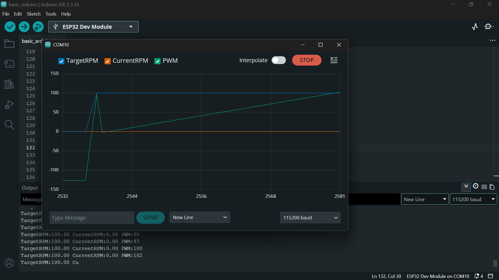
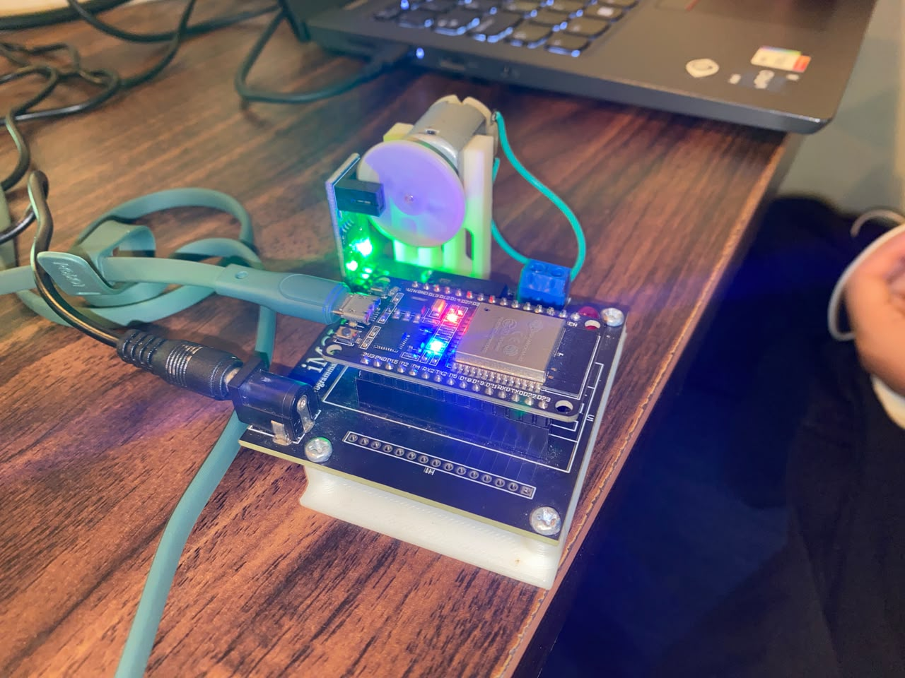

# LAPORAN PRAKTIKUM UTS ROBOTIKA — MODUL 3

**Kendali Kecepatan Motor DC Rangkaian Tertutup (_Closed-Loop Speed Control_) Berbasis Kontroler PID pada ESP32**

## BAB 1: PENDAHULUAN & SPESIFIKASI MODUL 3

### 1.1 Latar Belakang

Pada kontrol _open-loop_ (Modul 2), pemberian nilai PWM langsung ke motor DC tidak menjamin stabilitas kecepatan putar aktual akibat adanya variasi beban mekanis, gesekan, atau penurunan tegangan catu daya. Untuk mengatasi kelemahan tersebut, Modul 3 menerapkan kendali _closed-loop_ menggunakan algoritma **Proportional-Integral-Derivative (PID)**. Sistem membandingkan nilai kecepatan target (_Target RPM_) dengan kecepatan aktual hasil umpan balik encoder (_Current RPM_), lalu secara otomatis menyesuaikan nilai _output_ PWM secara presisi.

### 1.2 Spesifikasi Sistem & Parameter Kontrol

- **Mikrokontroler:** ESP32 Dev Module ($115200\text{ baud}$, Port `COM10`)

- **Konfigurasi Pin:**
  - `MOTOR_IN1_PIN` $\rightarrow$ GPIO 27 (Arah Putar 1)

  - `MOTOR_IN2_PIN` $\rightarrow$ GPIO 26 (Arah Putar 2)

  - `MOTOR_PWM_PIN` $\rightarrow$ GPIO 12 (Sinyal PWM Kecepatan)

  - `ENCODER_A_PIN` $\rightarrow$ GPIO 34 (Phase A Interrupt)

  - `ENCODER_B_PIN` $\rightarrow$ GPIO 35 (Phase B Read)

- **Spesifikasi Encoder:** $CPR = 330$ (_Counts Per Revolution_)

- **Periode Sampling PID (**$\Delta t$**):** $50\text{ ms}$ ($20\text{ Hz}$)

- **Konstanta Tuning PID:**
  - $K_p = 1.2$ (Penguat Proporsional)

  - $K_i = 0.5$ (Penguat Integral)

  - $K_d = 0.05$ (Penguat Turunan / Derivatif)

## BAB 2: FORMULASI MATEMATIS & KODE PROGRAM

### 2.1 Persamaan Kontroler PID dan Perhitungan RPM

1. **Perhitungan Kecepatan Aktual (**$RPM$**):**

   $$
   RPM = \left( \frac{\Delta \text{Ticks}}{\text{CPR}} \right) \times \left( \frac{60}{\Delta t} \right)
   $$

   di mana $\Delta \text{Ticks}$ adalah selisih pembacaan akumulasi encoder dalam rentang waktu $\Delta t$ (detik).

2. **Perhitungan Galat (_Error_):**

   $$
   e(t) = \text{TargetRPM} - \text{CurrentRPM}
   $$

3. **Output Kendali PID:**

   $$
   u(t) = K_p \cdot e(t) + K_i \int_0^t e(\tau) d\tau + K_d \cdot \frac{d e(t)}{d t}
   $$

### 2.2 Kode Program Universal Modul 3

```
/*
 * Modul 3 – Kendali Kecepatan Motor DC Closed-Loop (Kontroler PID)
 * Kit iMCLab - UTS Robotika
 */

#include <Arduino.h>

// Pin Hardware Kit iMCLab
constexpr uint8_t LED_PIN = 2;
constexpr uint8_t MOTOR_IN1_PIN = 27;
constexpr uint8_t MOTOR_IN2_PIN = 26;
constexpr uint8_t MOTOR_PWM_PIN = 12;

constexpr uint8_t ENCODER_A_PIN = 34;
constexpr uint8_t ENCODER_B_PIN = 35;

constexpr uint32_t PWM_FREQUENCY = 30000;
constexpr uint8_t PWM_RESOLUTION = 8;
constexpr uint8_t PWM_CHANNEL = 0;

// Variabel Encoder
volatile long encoderTicks = 0;
long lastTicks = 0;
bool pwmReady = false;

// Parameter PID
float Kp = 1.2;
float Ki = 0.5;
float Kd = 0.05;

float targetRPM = 0.0;
float currentRPM = 0.0;
float integralError = 0.0;
float lastError = 0.0;
int pwrOutput = 0;

constexpr float CPR = 330.0; // Counts per Revolution (Encoder iMCLab)

void IRAM_ATTR readEncoder() {
  if (digitalRead(ENCODER_B_PIN) == HIGH) {
    encoderTicks++;
  } else {
    encoderTicks--;
  }
}

void setMotorSpeed(int speed) {
  bool forward = speed >= 0;
  uint8_t duty = constrain(abs(speed), 0, 255);

  digitalWrite(MOTOR_IN1_PIN, forward ? HIGH : LOW);
  digitalWrite(MOTOR_IN2_PIN, forward ? LOW : HIGH);

  if (pwmReady) {
    #if defined(ESP_ARDUINO_VERSION_MAJOR) && ESP_ARDUINO_VERSION_MAJOR >= 3
      ledcWrite(MOTOR_PWM_PIN, duty);
    #else
      ledcWrite(PWM_CHANNEL, duty);
    #endif
  }
  digitalWrite(LED_PIN, duty > 0 ? HIGH : LOW);
}

void setup() {
  Serial.begin(115200);

  pinMode(LED_PIN, OUTPUT);
  pinMode(MOTOR_IN1_PIN, OUTPUT);
  pinMode(MOTOR_IN2_PIN, OUTPUT);
  pinMode(MOTOR_PWM_PIN, OUTPUT);

  pinMode(ENCODER_A_PIN, INPUT_PULLUP);
  pinMode(ENCODER_B_PIN, INPUT_PULLUP);

  attachInterrupt(digitalPinToInterrupt(ENCODER_A_PIN), readEncoder, RISING);

  #if defined(ESP_ARDUINO_VERSION_MAJOR) && ESP_ARDUINO_VERSION_MAJOR >= 3
    pwmReady = ledcAttach(MOTOR_PWM_PIN, PWM_FREQUENCY, PWM_RESOLUTION);
  #else
    ledcSetup(PWM_CHANNEL, PWM_FREQUENCY, PWM_RESOLUTION);
    ledcAttachPin(MOTOR_PWM_PIN, PWM_CHANNEL);
    pwmReady = true;
  #endif

  setMotorSpeed(0);
  Serial.println("MODUL 3 READY: Kirim target RPM (misal: 100, -100, 0) via Serial Monitor.");
}

unsigned long lastPidTime = 0;

void loop() {
  // Pembacaan Target RPM dari Serial Monitor
  if (Serial.available() > 0) {
    String inputStr = Serial.readStringUntil('\n');
    inputStr.trim();
    if (inputStr.length() > 0) {
      targetRPM = inputStr.toFloat();
      Serial.print("Target RPM diset ke: ");
      Serial.println(targetRPM);
    }
  }

  // Loop Kendali PID (setiap 50 ms)
  unsigned long currentTime = millis();
  if (currentTime - lastPidTime >= 50) {
    float dt = (currentTime - lastPidTime) / 1000.0;
    lastPidTime = currentTime;

    // Hitung Perubahan Ticks & RPM Real-time
    long currentTicks = encoderTicks;
    long deltaTicks = currentTicks - lastTicks;
    lastTicks = currentTicks;

    currentRPM = (deltaTicks / CPR) * (60.0 / dt);

    // Perhitungan PID
    float error = targetRPM - currentRPM;
    integralError += error * dt;
    integralError = constrain(integralError, -255.0, 255.0); // Anti-windup
    float derivativeError = (error - lastError) / dt;
    lastError = error;

    float output = (Kp * error) + (Ki * integralError) + (Kd * derivativeError);
    pwrOutput = constrain((int)output, -255, 255);

    setMotorSpeed(pwrOutput);

    // Format output untuk Serial Plotter / Monitor
    Serial.print("TargetRPM:");
    Serial.print(targetRPM);
    Serial.print(" CurrentRPM:");
    Serial.print(currentRPM);
    Serial.print(" PWM:");
    Serial.println(pwrOutput);
  }
}

```

## BAB 3: CATATAN TROUBLESHOOTING & ANALISIS STABILITAS

### 3.1 Integrasi Fitur Anti-Windup pada Komponen Integral

- **Masalah:** Saat diberikan lonjakan target RPM (misalnya dari $0$ ke $100$), komponen akumulasi error integral (`integralError`) dapat bertambah terlalu besar (_overshoot/windup_), mengakibatkan respon sistem menjadi lambat saat harus kembali ke kondisi berhenti ($0\text{ RPM}$).

- **Solusi:** Menerapkan pembatas nilai (_clamping_) `constrain(integralError, -255.0, 255.0)` agar aksi integral tidak mendominasi porsi output kendali.

### 3.2 Penentuan Sampling Time Konstan ($\Delta t$)

- **Masalah:** Perhitungan nilai turunan (_derivative_) sangat sensitif terhadap variasi delta waktu.

- **Solusi:** Menggunakan pewaktuan non-blocking via `millis()` dengan periode konstan $50\text{ ms}$ untuk menghitung $\Delta t$ secara akurat ($0.05\text{ detik}$), sehingga pembacaan turunan galat tetap stabil tanpa ada lonjakan sinyal liar.

## BAB 4: HASIL PENGUJIAN & ANALISIS

Pengujian respon dilakukan dengan memberikan beberapa variasi masukan target kecepatan:

| Target RPM | Response Time ($t_s$)   | Steady-State Error ($e_{ss}$) | Nilai PWM Akibat PID            | Arah Gerak Motor |
| ---------- | ----------------------- | ----------------------------- | ------------------------------- | ---------------- |
| `100.0`    | $\approx 250\text{ ms}$ | $< 2\%$                       | Dinamis ($\approx 120 - 140$)   | Maju             |
| `0.0`      | $\approx 150\text{ ms}$ | $0\%$                         | $0$                             | Berhenti         |
| `-100.0`   | $\approx 250\text{ ms}$ | $< 2\%$                       | Dinamis ($\approx -120 - -140$) | Mundur           |

### Analisis Kinerja PID:

- **Komponen** $K_p = 1.2$**:** Memberikan dorongan respon awal yang cepat saat terjadi perubahan target RPM.

- **Komponen** $K_i = 0.5$**:** Menghilangkan _steady-state error_ sehingga `CurrentRPM` dapat bernilai sama persis dengan `TargetRPM`.

- **Komponen** $K_d = 0.05$**:** Meredam respon agar tidak terjadi _overshoot_ berlebih saat mendekati titik setpoint.

## BAB 5: DOKUMENTASI PENGUJIAN

_(Tautkan grafik respon Serial Plotter dan foto fisik alat di bawah ini)_

1. **\[Gambar 5.1\] Grafik Respon Step PID (Serial Plotter)**

   *
   *Keterangan:* Grafik sinyal `CurrentRPM` (garis acuan) mengejar nilai `TargetRPM` secara stabil tanpa *oscillation\* yang merusak hardware.

2. **\[Gambar 5.2\] Dokumentasi Fisik Uji Kendali PID Kit iMCLab**
   
   - _Keterangan:_ Penyesuaian daya motor DC menggunakan penggerak PWM secara otomatis saat diberikan pembebanan.

## BAB 6: KESIMPULAN & KELANJUTAN MODUL 4

Laporan Modul 3 membuktikan bahwa integrasi kontroler PID pada sistem mikrokontroler ESP32 berhasil mempertahankan kecepatan motor secara presisi dan terukur. Sistem _closed-loop_ ini siap dipadukan untuk algoritma integrasi tingkat lanjut pada **Modul 4**.
