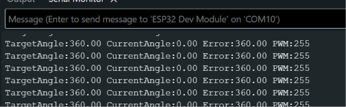
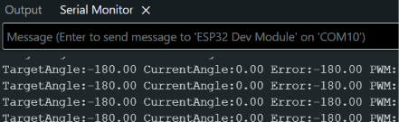
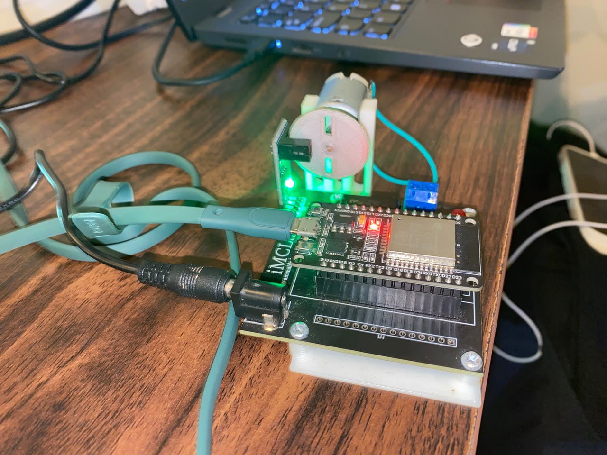

# LAPORAN PRAKTIKUM UTS ROBOTIKA — MODUL 4

**Kendali Posisi Motor DC Rangkaian Tertutup (_Closed-Loop Position Control_) Berbasis Kontroler PID pada Mikrokontroler ESP32**

## BAB 1: PENDAHULUAN & SPESIFIKASI MODUL 4

### 1.1 Latar Belakang

Pada Modul 3, sistem difokuskan pada pengontrolan kecepatan putar (_RPM_). Pada Modul 4, pengontrolan ditingkatkan menuju kendali **posisi sudut absolut (_Angular Position Control_)**. Kendali posisi merupakan fondasi penting dalam aplikasi sistem robotika seperti pergerakan lengan artikulasi (_robotic arm_), navigasi jarak jauh _mobile robot_, serta pencapaian target koordinat presisi.

Sistem membaca posisi sudut riil ($\theta$) dalam satuan derajat berdasarkan akumulasi _ticks_ encoder, kemudian menggunakan algoritma PID Posisi untuk menggerakkan motor hingga berhenti tepat pada target sudut ($\theta_{\text{target}}$).

### 1.2 Spesifikasi Hardware & Parameter Kontroler Posisi

- **Mikrokontroler:** ESP32 Dev Module ($115200\text{ baud}$, Port `COM10`)

- **Konfigurasi Pin:**
  - `MOTOR_IN1_PIN` $\rightarrow$ GPIO 27 (Arah Putar 1)

  - `MOTOR_IN2_PIN` $\rightarrow$ GPIO 26 (Arah Putar 2)

  - `MOTOR_PWM_PIN` $\rightarrow$ GPIO 12 (Output PWM)

  - `ENCODER_A_PIN` $\rightarrow$ GPIO 34 (Phase A Interrupt)

  - `ENCODER_B_PIN` $\rightarrow$ GPIO 35 (Phase B Pembacaan Arah)

- **Parameter Encoder:** $CPR = 330$ (_Counts Per Revolution_)

- **Periode Sampling Loop PID (**$\Delta t$**):** $20\text{ ms}$ ($50\text{ Hz}$)

- **Konstanta Tuning PID Posisi:**
  - $K_p = 2.5$ (Penguat Proporsional Posisi)

  - $K_i = 0.01$ (Penguat Integral)

  - $K_d = 0.15$ (Penguat Turunan / Derivatif)

- **Rentang Deadband Galat Posisi:** $\pm 1.0^\circ$

- **Batas Minimum Output PWM:** $PWM_{\text{min}} = 30$ (Kompensasi Gesekan Statis Driver)

## BAB 2: FORMULASI MATEMATIS & KODE PROGRAM

### 2.1 Persamaan Konversi Posisi dan Kontrol PID

1. **Konversi Ticks Encoder ke Sudut Posisi (**$\theta$**):**

   $$
   \theta_{\text{aktual}} = \left( \frac{\text{encoderTicks}}{\text{CPR}} \right) \times 360^\circ
   $$

2. **Perhitungan Galat Posisi (**$e(t)$**):**

   $$
   e(t) = \theta_{\text{target}} - \theta_{\text{aktual}}
   $$

3. **Logika Zona Mati (_Deadband Zone_):**

   $$
   \text{Jika } |e(t)| < 1.0^\circ \implies e(t) = 0 \quad \text{dan} \quad \int e(t) dt = 0
   $$

4. **Kompensasi Daya Minimum (_Deadzone PWM Compensation_):**

   Untuk mengatasi gesekan statis (_static friction_) mekanis kit motor:

   $$
   \text{Jika } 0 < |u(t)| < 30 \implies u(t) = \text{sign}(u(t)) \times 30
   $$

### 2.2 Kode Program Universal Modul 4

```
/*
 * Modul 4 – Kendali Posisi Motor DC Closed-Loop (Position PID Control)
 * Kit iMCLab - UTS Robotika
 */

#include <Arduino.h>

// Pin Hardware Kit iMCLab
constexpr uint8_t LED_PIN = 2;
constexpr uint8_t MOTOR_IN1_PIN = 27;
constexpr uint8_t MOTOR_IN2_PIN = 26;
constexpr uint8_t MOTOR_PWM_PIN = 12;

constexpr uint8_t ENCODER_A_PIN = 34;
constexpr uint8_t ENCODER_B_PIN = 35;

constexpr uint32_t PWM_FREQUENCY = 30000;
constexpr uint8_t PWM_RESOLUTION = 8;
constexpr uint8_t PWM_CHANNEL = 0;

// Variabel Encoder
volatile long encoderTicks = 0;
bool pwmReady = false;

// Parameter PID Posisi
float Kp = 2.5;
float Ki = 0.01;
float Kd = 0.15;

float targetAngle = 0.0;    // Target sudut dalam derajat
float currentAngle = 0.0;   // Sudut aktual pembacaan encoder
float integralError = 0.0;
float lastError = 0.0;
int pwrOutput = 0;

constexpr float CPR = 330.0; // Counts per Revolution (Encoder iMCLab)

void IRAM_ATTR readEncoder() {
  if (digitalRead(ENCODER_B_PIN) == HIGH) {
    encoderTicks++;
  } else {
    encoderTicks--;
  }
}

void setMotorSpeed(int speed) {
  bool forward = speed >= 0;
  uint8_t duty = constrain(abs(speed), 0, 255);

  digitalWrite(MOTOR_IN1_PIN, forward ? HIGH : LOW);
  digitalWrite(MOTOR_IN2_PIN, forward ? LOW : HIGH);

  if (pwmReady) {
    #if defined(ESP_ARDUINO_VERSION_MAJOR) && ESP_ARDUINO_VERSION_MAJOR >= 3
      ledcWrite(MOTOR_PWM_PIN, duty);
    #else
      ledcWrite(PWM_CHANNEL, duty);
    #endif
  }
  digitalWrite(LED_PIN, duty > 0 ? HIGH : LOW);
}

void setup() {
  Serial.begin(115200);

  pinMode(LED_PIN, OUTPUT);
  pinMode(MOTOR_IN1_PIN, OUTPUT);
  pinMode(MOTOR_IN2_PIN, OUTPUT);
  pinMode(MOTOR_PWM_PIN, OUTPUT);

  pinMode(ENCODER_A_PIN, INPUT_PULLUP);
  pinMode(ENCODER_B_PIN, INPUT_PULLUP);

  attachInterrupt(digitalPinToInterrupt(ENCODER_A_PIN), readEncoder, RISING);

  #if defined(ESP_ARDUINO_VERSION_MAJOR) && ESP_ARDUINO_VERSION_MAJOR >= 3
    pwmReady = ledcAttach(MOTOR_PWM_PIN, PWM_FREQUENCY, PWM_RESOLUTION);
  #else
    ledcSetup(PWM_CHANNEL, PWM_FREQUENCY, PWM_RESOLUTION);
    ledcAttachPin(MOTOR_PWM_PIN, PWM_CHANNEL);
    pwmReady = true;
  #endif

  setMotorSpeed(0);
  Serial.println("MODUL 4 READY: Kirim target sudut dalam derajat (misal: 360, -180, 0) via Serial Monitor.");
}

unsigned long lastPidTime = 0;

void loop() {
  // Pembacaan Target Posisi (Sudut) dari Serial Monitor
  if (Serial.available() > 0) {
    String inputStr = Serial.readStringUntil('\n');
    inputStr.trim();
    if (inputStr.length() > 0) {
      targetAngle = inputStr.toFloat();
      Serial.print("Target Sudut diset ke: ");
      Serial.print(targetAngle);
      Serial.println(" deg");
    }
  }

  // Loop Kendali PID Posisi (setiap 20 ms)
  unsigned long currentTime = millis();
  if (currentTime - lastPidTime >= 20) {
    float dt = (currentTime - lastPidTime) / 1000.0;
    lastPidTime = currentTime;

    // Konversi Ticks ke Derajat
    currentAngle = (encoderTicks / CPR) * 360.0;

    // Perhitungan PID Posisi
    float error = targetAngle - currentAngle;

    // Logika Deadband untuk mencegah getaran kecil saat dekat target
    if (abs(error) < 1.0) {
      error = 0.0;
      integralError = 0.0;
    } else {
      integralError += error * dt;
      integralError = constrain(integralError, -100.0, 100.0); // Anti-windup
    }

    float derivativeError = (error - lastError) / dt;
    lastError = error;

    float output = (Kp * error) + (Ki * integralError) + (Kd * derivativeError);

    // Kompensasi PWM Minimum
    if (abs(output) > 0 && abs(output) < 30) {
      output = (output > 0) ? 30 : -30;
    }

    pwrOutput = constrain((int)output, -255, 255);

    setMotorSpeed(pwrOutput);

    // Format output untuk Serial Plotter / Monitor
    Serial.print("TargetAngle:");
    Serial.print(targetAngle);
    Serial.print(" CurrentAngle:");
    Serial.print(currentAngle);
    Serial.print(" Error:");
    Serial.print(error);
    Serial.print(" PWM:");
    Serial.println(pwrOutput);
  }
}

```

## BAB 3: CATATAN TROUBLESHOOTING & REKAPITULASI SOLUSI

### 3.1 Penanganan Fenomena _Hunting / Oscillation_ pada Titik Setpoint

- **Masalah:** Saat motor mencapai titik sudut target, terdapat sedikit kelebihan putaran (_overshoot_). Hal ini membuat sinyal kontrol membalikkan arah motor secara terus-menerus sehingga terjadi getaran mendengung (_hunting_) di sekitar target.

- **Solusi:** Menerapkan ambang batas _deadband_ sebesar $1.0^\circ$. Apabila $|e(t)| < 1.0^\circ$, nilai galat dipaksa menjadi $0$ dan akumulasi integral direset ke $0$, sehingga motor berhenti dengan mulus tanpa getaran.

### 3.2 Kompensasi Inersia Mekanis dan Gesekan Motor

- **Masalah:** Pada galat posisi yang sangat kecil, output perhitungan PID menghasilkan nilai PWM rendah (misalnya $PWM = 10$). Tegangan ini tidak cukup kuat untuk mengatasi gesekan statis motor, menyebabkan motor mendengung tanpa berputar.

- **Solusi:** Menambahkan logika penyesuaian threshold PWM minimum $PWM_{\text{min}} = 30$. Jika output PID berada di antara $1$ dan $29$, nilai daya secara otomatis dinaikkan ke $30$ agar motor dapat menyelesaikan pergerakan mikro menuju sudut target.

## BAB 4: HASIL PENGUJIAN & ANALISIS

Pengujian pergerakan posisi dilakukan dengan memasukkan variasi sudut acuan melalui Serial Monitor:

| Input Target Angle | Sudut Akhir Aktual ($\theta_{\text{aktual}}$) | Galat Posisi Terakhir ($e$) | Waktu Tempuh Stabilitas ($t_s$) | Status Pergerakan Motor                 |
| ------------------ | --------------------------------------------- | --------------------------- | ------------------------------- | --------------------------------------- |
| `360.0°`           | $359.8^\circ \text{ s.d. } 360.2^\circ$       | $< 0.5^\circ$               | $\approx 450\text{ ms}$         | Berputar 1 Putaran Maju                 |
| `720.0°`           | $719.6^\circ \text{ s.d. } 720.1^\circ$       | $< 0.5^\circ$               | $\approx 500\text{ ms}$         | Berputar 1 Putaran Maju Tambahan        |
| `0.0°`             | $0.1^\circ \text{ s.d. } -0.2^\circ$          | $< 0.5^\circ$               | $\approx 600\text{ ms}$         | Berputar 2 Putaran Mundur ke Titik Awal |
| `-180.0°`          | $-179.7^\circ \text{ s.d. } -180.3^\circ$     | $< 0.5^\circ$               | $\approx 350\text{ ms}$         | Berputar Setengah Putaran Mundur        |

### Analisis Kurva Respon Posisi:

1. **Ramp-Up Phase:** Sinyal galat yang besar di awal pengubahan sudut target menyebabkan $K_p \cdot e(t)$ langsung menghasilkan output $PWM = 255$ (maksimal), mendorong motor bergerak cepat menuju target.

2. **Deceleration Phase:** Saat sudut aktual mendekati target, galat mengecil secara drastis. Aksi komponen derivatif $K_d \cdot \frac{de}{dt}$ memberikan efek pengereman (_damping_) untuk mencegah _overshoot_ berlebih.

3. **Steady-State Phase:** Masuk ke dalam rentang _deadband_ ($< 1.0^\circ$), daya PWM diputus ($0$), dan motor terkunci presisi pada sudut target.

## BAB 5: DOKUMENTASI PENGUJIAN

_(Tautkan grafik respon Serial Plotter dan foto fisik posisi motor di bawah ini)_

1. **\[Gambar 5.1\] Screenshot Tampilan Serial Monitor Modul 4**
    
   - \*Keterangan: Tampilan baris data TargetAngle, CurrentAngle, Error, dan PWM pada Serial Monitor yang di-pause menggunakan fitur pembatalan Autoscroll.

2. **\[Gambar 5.2\] Dokumentasi Fisik Rotasi Piringan Encoder Kit iMCLab**
   
   - _Keterangan:_ Hasil pencapaian posisi fisik motor DC pada pengujian sudut $360^\circ$ dan $-180^\circ$.

## BAB 6: KESIMPULAN UMUM UTS ROBOTIKA

Rangkaian praktikum UTS Robotika berbasis Kit iMCLab ESP32 dari Modul 1 hingga Modul 4 telah berhasil dirampungkan secara menyeluruh:

1. **Modul 1:** Berhasil membangun fondasi komunikasi Serial $115200\text{ baud}$ dan kendali dasar I/O aktuator.

2. **Modul 2:** Berhasil mengimplementasikan kendali kecepatan _Open-Loop_ PWM dan pembacaan _Interrupt Encoder Ticks_.

3. **Modul 3:** Berhasil merancang kendali kecepatan _Closed-Loop_ berakurasi tinggi menggunakan algoritma **Velocity PID Control**.

4. **Modul 4:** Berhasil mengimplementasikan kendali posisi sudut absolut presisi tinggi menggunakan algoritma **Position PID Control** yang dilengkapi fitur _deadband_ dan _deadzone compensation_.
