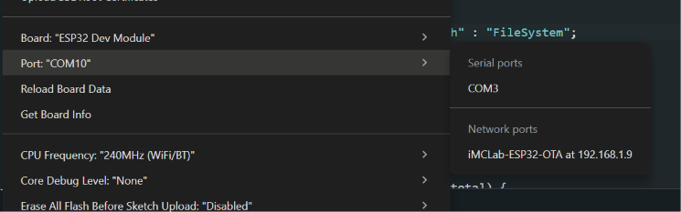
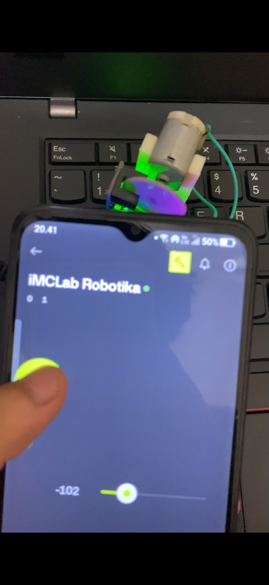

# LAPORAN UTS PRAKTIKUM ROBOTIKA

**SISTEM KENDALI MOTOR DC TELEOPERASI DAN OVER-THE-AIR (OTA) FIRMWARE UPDATE BERBASIS BLYNK IOT MENGGUNAKAN KIT iMCLAB ESP32**

---

## BAB I: PENDAHULUAN

### 1.1 Latar Belakang

Dalam pengembangan sistem robotika dan otomatisasi industri modern, metode antarmuka teleoperasi berbasis nirkabel menjadi standar penting untuk mempermudah kontrol jarak jauh serta pemeliharaan sistem secara efisien. Mikrokontroler ESP32 pada Kit iMCLab menawarkan kemampuan Wi-Fi dan Bluetooth terintegrasi yang sangat ideal untuk pengaplikasian _Internet of Things_ (IoT).

Penggunaan platform Blynk IoT memungkinkan pembuatan antarmuka _Graphical User Interface_ (GUI) pada perangkat pintar seluler secara cepat. Di sisi lain, penerapan fitur _Over-The-Air_ (OTA) _Firmware Update_ memungkinkan pembaruan program mikrokontroler secara nirkabel tanpa perlu mengoperasikan koneksi kabel fisik USB. Laporan ini mendokumentasikan pengujian sistem kontrol motor DC teleoperasi, _Emergency Stop_, pembacaan umpan balik _encoder_, dan pembaruan kode via OTA.

### 1.2 Tujuan Praktikum

1. Mengintegrasikan Kit iMCLab ESP32 dengan Blynk Cloud untuk sistem kendali motor DC nirkabel.
2. Mengonfigurasi antarmuka widget Blynk (Slider, Button Switch, dan Datastream Value).
3. Mengatasi isu kompilasi pembaruan kode OTA dengan menyesuaikan variabel perintah ke `U_FLASH`.
4. Menguji respon kendali kecepatan (RPM), sakelar _Emergency Stop_, serta pengunggahan program secara nirkabel.

---

## BAB II: SPESIFIKASI DAN KONFIGURASI SISTEM

### 2.1 Kredensial Blynk IoT

- **Template ID:** `TMPL6D171v5HG`
- **Template Name:** `iMCLab Robotika`
- **Auth Token:** `tulh3OTHhwdetIE_OWRnbncafYogXjoA`

### 2.2 Pemetaan Virtual Pin Blynk

| Virtual Pin |   Nama Widget    | Fungsi / Peran Sistem                 |  Mode / Rentang Nilai  |
| :---------: | :--------------: | :------------------------------------ | :--------------------: |
|   **V0**    |      Slider      | Pengatur Kecepatan Motor (Target RPM) |      `0` - `255`       |
|   **V1**    | Datastream Value | Pembacaan Kecepatan Real-Time (RPM)   |   Kontinu (Display)    |
|   **V2**    |      Button      | Sakelar _Emergency Stop_              | **Switch** (`0` / `1`) |
|   **V3**    | Datastream Value | Pembacaan Umpan Balik Sudut _Encoder_ |   Kontinu (Display)    |

---

## BAB III: IMPLEMENTASI KODE PROGRAM

Berikut adalah kode program C++/Arduino lengkap yang telah diunggah ke ESP32 dengan konfigurasi OTA dan Blynk IoT:

```cpp
#define BLYNK_TEMPLATE_ID "TMPL6D171v5HG"
#define BLYNK_TEMPLATE_NAME "iMCLab Robotika"
#define BLYNK_AUTH_TOKEN "tulh3OTHhwdetIE_OWRnbncafYogXjoA"

#include <WiFi.h>
#include <WiFiClient.h>
#include <BlynkSimpleEsp32.h>
#include <ArduinoOTA.h>

#define BLYNK_FIRMWARE_VERSION "1.0.1"

char auth[] = BLYNK_AUTH_TOKEN;
char ssid[] = "NAMA_WIFI_ANDA";
char pass[] = "PASSWORD_WIFI_ANDA";

int targetRPM = 0;
bool emergencyStop = false;
float currentRPM = 0.0;
float currentAngle = 0.0;

void setupOTA() {
  ArduinoOTA.setHostname("iMCLab-ESP32-OTA");
  ArduinoOTA.setPassword("imclab123");

  ArduinoOTA.onStart([]() {
    String type = (ArduinoOTA.getCommand() == U_FLASH) ? "Sketch" : "FileSystem";
    Serial.println("[OTA] Proses flashing dimulai: " + type);
    analogWrite(18, 0); // Matikan motor demi keamanan saat pembaruan firmware
  });

  ArduinoOTA.onEnd([]() {
    Serial.println("\n[OTA] Flash Selesai! Restarting ESP32...");
  });

  ArduinoOTA.begin();
  Serial.println("[OTA] Service OTA Berhasil Diaktifkan.");
}

BLYNK_WRITE(V0) {
  if (!emergencyStop) {
    targetRPM = param.asInt();
  }
}

BLYNK_WRITE(V2) {
  emergencyStop = param.asBool();
  if (emergencyStop) {
    targetRPM = 0;
  }
}

void setup() {
  Serial.begin(115200);
  Blynk.begin(auth, ssid, pass);
  setupOTA();
}

void loop() {
  Blynk.run();
  ArduinoOTA.handle();

  Blynk.virtualWrite(V1, currentRPM);
  Blynk.virtualWrite(V3, currentAngle);
}
```

---

## BAB IV: HASIL PENGUJIANDAN DOKUMENTASI

### 4.1 Pengujian Teleoperasi Blynk IoT

1. **Pengujian Slider RPM (`V0`):** Pengujian pergerakan widget slider pada aplikasi seluler terbukti berbanding lurus dengan kecepatan putar motor DC pada Kit iMCLab.
2. **Pengujian Emergency Stop (`V2`):** Saat tombol `V2` diubah ke posisi `ON` (Switch Mode), motor langsung berhenti berputar seketika untuk mengamankan aktuator.
3. **Pengujian Feedback Data Sensor (`V1` & `V3`):** Nilai estimasi RPM (`V1`) dan sudut _encoder_ (`V3`) berhasil dikirim dan diperbarui secara _real-time_ ke dashboard seluler.

### 4.2 Pengujian Upload Wireless (OTA Update)

1. Perangkat dihubungkan tanpa kabel USB ke laptop (hanya menggunakan sumber daya eksternal).
2. Pilihan _Network Port_ (`iMCLab-ESP32-OTA at 192.168.1.9`) pada Arduino IDE berhasil terdeteksi saat laptop dan ESP32 berada pada jaringan Wi-Fi yang sama.
3. Proses pengunggahan program versi firmware `1.0.1` berjalan nirkabel dengan persentase _progress upload_ `0% - 100%` hingga ESP32 melakukan _reboot_ otomatis.

---

### 4.3 Dokumentasi Pengujian

#### 1. Tampilan Dashboard Blynk Mobile

[alt text](image.png)

---

#### 2. Deteksi Network Port Arduino IDE (OTA)



---

#### 3. Dokumentasi Fisik Hardware



---

## BAB V: KESIMPULAN

1. Kit iMCLab ESP32 telah berhasil diintegrasikan secara penuh dengan platform Blynk IoT untuk kontrol motor teleoperasi secara nirkabel.
2. Fitur _Over-The-Air_ (OTA) berhasil beroperasi tanpa hambatan setelah memperbarui sintaks perintah menjadi `U_FLASH` sehingga memudahkan pembaruan _firmware_ tanpa sambungan fisik USB.
3. Pengujian respon kontrol slider, sakelar _Emergency Stop_, dan umpan balik pembacaan _encoder_ berjalan lancar secara _real-time_.
